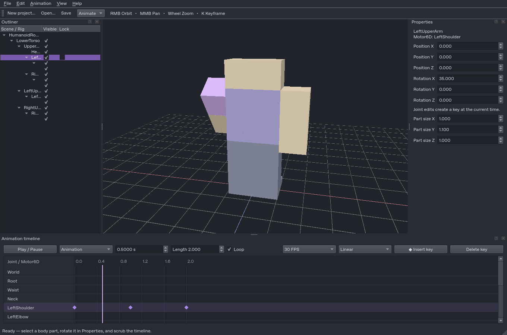

# RobBench

Native C++20 Roblox rig animation editor using **Qt 6 Widgets and Vulkan 1.3**.
Independent implementation informed by Blockbench's workflow; not affiliated with Roblox or Blockbench.

**Development status: working animation-authoring foundation, not the completed master specification.**
See [verified capabilities and remaining work](docs/STATUS.md) before evaluating feature coverage.



## Working today

- Dockable dark desktop editor with outliner, properties, timeline, and saved layouts.
- R6 and R15 block authoring templates; custom Motor6D hierarchies through project import.
- Vulkan rendering with VMA, GLSL/SPIR-V, depth testing, directional shading, grid and selection tint.
- Orbit/pan/zoom, perspective/orthographic views, focus, ray picking and optional 4x MSAA.
- Direct move/rotate/resize gizmos, local/world joint axes, snapping and transactional drag undo.
- Joint position/rotation editing, multiple clips, key insertion/deletion/dragging, frame snapping, loop/playback.
- Quaternion SLERP with linear, step, ease-in/out and smoothstep easing.
- Undo/redo, atomic `.robbench` saves, reopen, recovery snapshots, recent files.
- Versioned baked `.rbanim` export/import and a Studio companion plugin.
- Add/resize/delete cubes. Advanced mesh, texture, UV and IK tools are not implemented.

## Windows download

[RobBench v0.1.0 — Windows portable ZIP and installer](https://github.com/Lyvt-Dev/RobBench/releases/tag/v0.1.0).
The release also includes the Roblox Studio companion plugin source. Windows GPU rendering, clean-machine
interactive installation and Roblox Studio playback remain to be verified; see the release notes.

## Build

Windows: Visual Studio 2022 **Desktop development with C++**, CMake 3.25+, Git and vcpkg.
Set `VCPKG_ROOT` to a bootstrapped vcpkg checkout. The manifest pins a baseline and supplies
Qt, Vulkan headers/loader/Hpp, VMA, glslang, GLM, JSON, spdlog and GoogleTest.
Assimp, tinygltf and stb are provisioned for later import/texturing work; they are not exposed as supported formats yet.

```powershell
./scripts/dev.ps1 configure windows-debug
./scripts/dev.ps1 build windows-debug
./scripts/dev.ps1 test windows-debug
./build/windows-debug/Debug/RobBench.exe
```

Portable ZIP and NSIS installer (install NSIS first):

```powershell
./scripts/dev.ps1 configure windows-release
./scripts/dev.ps1 build windows-release
./scripts/dev.ps1 test windows-release
./scripts/dev.ps1 package windows-release
```

Windows Debug/Release compilation, core tests and ZIP/NSIS generation have passed in GitHub Actions.
The latest workflow also checks that the extracted Windows application can load its native Qt platform and runtime DLLs.
Actual Windows GPU rendering and interactive clean-machine installation remain manual verification steps.
GitHub Actions runs both configurations and only packages after tests pass. Tagged `v*` builds release the tested packages.

Linux: install Qt 6 Widgets development files, Vulkan 1.3 headers/loader and driver, glslangValidator,
VMA headers, GLM, nlohmann-json, spdlog, GoogleTest, CMake and Ninja. For example, on Debian 13:

```sh
apt-get install g++ cmake ninja-build qt6-base-dev libvulkan-dev mesa-vulkan-drivers \
    glslang-tools libglm-dev nlohmann-json3-dev libspdlog-dev libgtest-dev
# Install Vulkan Memory Allocator 3.2.1+ headers separately (or use vcpkg).
cmake --preset linux-debug -DVMA_INCLUDE_DIR=/path/to/VulkanMemoryAllocator/include
cmake --build --preset linux-debug
ctest --preset linux-debug
./build/linux-debug/RobBench
```

`glslangValidator` is found on PATH, in the Vulkan SDK, or vcpkg's tools directory.
No OpenGL renderer or embedded browser is used. Qt's platform libraries can have their own transitive system graphics dependencies.
macOS/MoltenVK support is not yet verified or packaged.

## Animate an arm

1. File → New project → R15 (or R6). Right-drag to orbit, middle-drag to pan; wheel zooms.
2. Select an upper arm in the viewport or outliner. At time 0, press **K** to key the rest pose.
3. Set time to 1 second. Change Rotation X in Properties and finish the edit. This creates a key.
4. At time 2, change Rotation X back to 0. Press Space or Play/Pause.
5. Save with Ctrl+S. Reopen with Ctrl+O. Export through File → Export animation.
6. Follow [the Studio workflow](docs/STUDIO_WORKFLOW.md) to import and verify it.

Keys hold their first value before their first timestamp, so insert a rest key **before** the first rotation.
Inspector edits automatically key the selected joint. The easing selector applies to newly inserted/edited keys;
set the selector and press K to change an existing key's outgoing interpolation.
Press **W**, **E** or **R** to move/rotate joints or resize block geometry directly in the viewport.
Drag a colored axis/ring; Shift snaps, Esc cancels, and releasing commits one undo step.
See [transform controls and pivot semantics](docs/TRANSFORMS.md).
Drag timeline diamonds to move keys; occupied destinations are rejected. Ctrl+wheel zooms the timeline.
F focuses selection; 1/3/7 select front/right/top; 5 toggles orthographic; Shift+K deletes the current key.
Delete removes the selected part and its descendants. Cube creation uses Ctrl+Shift+C.

The provided block templates are not authoritative avatar geometry or pivots. For an existing Roblox avatar,
**export its exact rig from Studio first**, open that `.robbench` project, and animate it.
For template animations, the plugin can create a matching block rig from `.rbanim`.
Mismatched pivots are rejected, not automatically retargeted.

## Verification

```sh
# Requires a working display and Vulkan 1.3 driver, including software Vulkan:
cmake -S . -B build/linux-debug -DROBBENCH_VULKAN_TESTS=ON
ctest --test-dir build/linux-debug --output-on-failure
# Or run an editor smoke test directly:
./build/linux-debug/RobBench --smoke-test build/smoke --smoke-rig R15
```

The smoke test saves a project, reopens it, exports animation, exercises mouse-driven move/rotate/resize,
preview isolation, cancellation, undo/redo and input shortcut protection, and captures real viewport pixels.
`RobBench --check-runtime` checks native Qt/platform startup without requiring Vulkan device initialization.
See [validation results](docs/VALIDATION.md), [format specification](docs/FORMATS.md),
[architecture](docs/ARCHITECTURE.md) and [reference research](docs/REFERENCES.md).

## License

RobBench's original code is MIT licensed. Dependencies retain their respective licenses;
see [third-party notices](THIRD_PARTY_NOTICES.md). No Blockbench source or assets are included.
